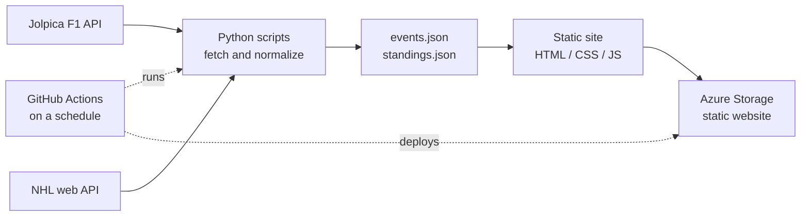

# Daehyeon's Sports Calendar

A personal sports calendar that pulls F1 and Ottawa Senators schedules from public APIs, shows every start time in Ottawa time, and refreshes itself on a schedule with no server to run.

**Live site:** <!-- TODO: add after deployment --> `https://<your-site>.azurestaticapps.net`

<!-- TODO: add screenshots after deployment


-->

## Why I built it

I follow F1 (Oscar Piastri in particular) and the Ottawa Senators, and their schedules live on different sites in different time zones. An F1 qualifying session in Qatar and a Senators game in Vancouver are both "tonight" for me, but no single page showed them together in my own time. So I built one.

## Features

- **Weekly strip + event list:** this week at a glance, with dots on days that have events; click a day to see its events with start times
- **Monthly calendar** with its own navigation, kept in sync with the selected day
- **Ottawa time everywhere (24-hour),** with the venue's local date and time under each event and in a hover tooltip
- **F1:** every session of the 2026 and 2027 seasons, round numbers, sprint-weekend badges, and Oscar Piastri's result for qualifying, sprint, and race (position and points)
- **NHL:** every Senators game with Home/Away badges and final scores (including OT/SO)
- **Live status:** countdowns for upcoming events and a LIVE badge while one is in progress
- **Standings:** F1 drivers and constructors (paged, with Piastri and McLaren always visible) and all four NHL divisions (Senators highlighted)
- **League filter chips, light/dark mode toggle,** and a layout that works on phones and desktops

## Tech stack

| Part | Tools |
|---|---|
| Data collection | Python 3 (standard library only: `urllib`, `json`) |
| Front end | HTML, CSS, vanilla JavaScript (no frameworks or libraries) |
| Data sources | [Jolpica F1 API](https://github.com/jolpica/jolpica-f1), NHL web API (unofficial) |
| Automation | GitHub Actions (scheduled workflow) |
| Hosting | Azure Blob Storage static website |

## How it works



1. GitHub Actions runs the Python scripts twice a day, plus every 3 hours from Friday to Monday so F1 weekend results show up quickly.
2. The scripts fetch schedules, results, and standings, then turn the two very different API formats into one common event format.
3. The site loads that JSON and does all the time-zone conversion in the browser.
4. The `site` folder is uploaded to an Azure Storage static website. There's no backend, database, or always-on server.

## Design decisions and problems I worked through

- **Store time once, convert at display time.** Every event is stored as a UTC timestamp plus the venue's IANA time zone (for example `Asia/Qatar`). The browser converts that to Ottawa time for display and to venue time for the tooltip. This handles daylight saving time and events whose date depends on the time zone: a 21:00 race in Qatar is 13:00 the same day in Ottawa, while the Las Vegas night race is dated Sunday in UTC but starts Saturday evening in Ottawa.
- **The F1 API doesn't give time zones.** Jolpica returns each circuit's city and country but no time zone, so I keep a small circuit-to-time-zone table, and the build prints a warning if a new circuit appears.
- **Data that doesn't exist yet.** The 2027 F1 calendar was announced, but the API had no 2027 races. The scripts fall back to a hand-made calendar (race dates only, times marked TBD) and switch to the API data automatically once it's published.
- **Unreliable and undocumented APIs.** During testing the F1 API returned a Cloudflare `530` error, and the first version gave up on all F1 data because of one failed request. I added retries with increasing waits (2 s, 4 s, 8 s) for server errors, made each part fail on its own (missing sprint results don't hide the schedule), and made deploys keep the previously published data for a league whose API is down.
- **Browser caching.** After updating files, the page kept running old JavaScript, so new buttons did nothing. On the live site, every file is uploaded with a `Cache-Control: no-cache` header so browsers re-check for updates on each visit.
- **Cloud restrictions change the plan.** I first tried Azure Static Web Apps, but creation was blocked by policy (`RequestDisallowedByAzure`). Checking my subscription's policy assignment showed why: Azure for Students only let me deploy to five regions (North Central US, West US, France Central, Norway East, Sweden Central), and none of them are regions where Static Web Apps is offered. I switched to static website hosting on Azure Blob Storage in North Central US, the allowed region closest to Ottawa. Only the deploy step changed; the data scripts and the site stayed the same.
- **No server, almost no cost.** A scheduled GitHub Actions job replaces a server. It fetches, builds, and deploys in a few minutes, within GitHub's free limits, and Blob Storage costs only cents a month for a site this small.

## How I built this (and how I used AI)

I built this project with **Claude**, Anthropic's AI assistant, over a few long working sessions. I want to be clear about who did what.

**What I did**
- Came up with the idea and set the requirements: which leagues, Ottawa time, local-time tooltips, and what the main page should show
- Made the product and design decisions through back-and-forth discussion: dropping KBO for now, showing only Senators games, replacing generic F1 results with Oscar Piastri's results, keeping practice sessions as times only, adding constructor standings, paging the F1 standings, adding a division toggle, Home/Away as small pill badges, 24-hour time, weeks starting on Sunday, a dark mode toggle, toggles pinned to the top right, an orange accent color, and a pixel-art cap icon
- Chose to host on Azure with my student account, and when Static Web Apps was blocked by my subscription's region policy, chose Blob Storage over the alternatives
- Ran everything on my own machine with real data, reported problems (the API `530` error, buttons not responding), and tracked one down to my own mistake (I hadn't re-run the data script)
- Edited the code myself for smaller changes: session labels, color values, and the site title

**What Claude did**
- Researched which data sources were available and checked the real API response formats
- Proposed the architecture (fetch script, then JSON, then static site, then scheduled deploy) and explained the trade-offs
- Wrote most of the code: the Python data scripts, the HTML/CSS/JavaScript front end, and the GitHub Actions workflow
- Tested the code with mock API responses and headless-browser screenshots at different screen sizes, and fixed the bugs it found
- Explained concepts along the way, such as what `localhost` and ports are, why opening the HTML file directly fails, how time zones are handled, and how deployment works

**What I learned**
- How REST APIs return data, and how different two sources' formats can be for the same kind of information
- Why storing times in UTC with an IANA time zone is the reliable way to handle time zones and daylight saving time
- How a static site, a scheduled CI job, and cloud hosting can replace a backend for a project like this
- Practical debugging: reading error codes, isolating whether a problem is in the code, the data, or the browser cache

## Roadmap

- Add KBO (Korean baseball) once the next season's schedule is published
- Broadcast info (which channel to watch on)
- Preseason and playoff badges for NHL games

## Running it locally

Setup, configuration, and deployment details are in [docs/SETUP.md](docs/SETUP.md). Short version:

```bash
python scripts/build_data.py
python -m http.server 8000 -d site
# then open http://localhost:8000
```

## Data sources

- F1 data: [Jolpica F1 API](https://github.com/jolpica/jolpica-f1), the community-run successor to the Ergast API
- NHL data: the NHL's public web API (`api-web.nhle.com`). It's undocumented; the community reference at [Zmalski/NHL-API-Reference](https://github.com/Zmalski/NHL-API-Reference) was helpful.

This is a personal, non-commercial project and isn't affiliated with Formula 1, the FIA, the NHL, or any team.
